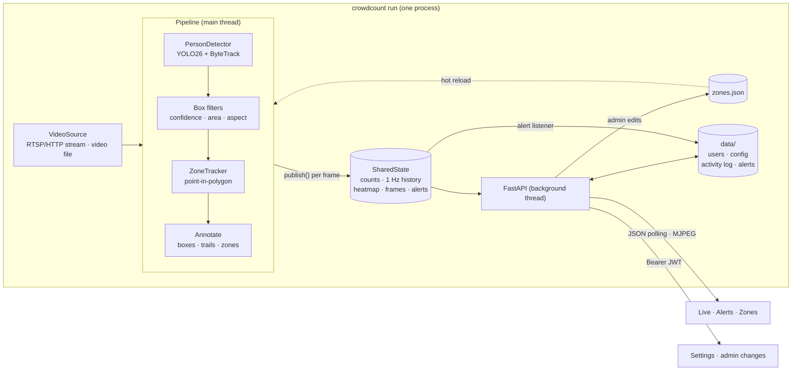

# Architecture

CrowdCount is a single Python process. The detection pipeline runs in the main thread
(OpenCV needs it for preview windows on macOS) and the FastAPI server runs in a background
thread. They share one in-memory `SharedState` object. Nothing goes over the network
between them, so `crowdcount run` is the only way to get live data on the dashboard;
`crowdcount detect` and `crowdcount serve` are the two halves on their own.

## Modules

| Module | Responsibility |
| --- | --- |
| `crowdcount.cli` | The `crowdcount` command. Validates zones, opens the source, starts the server, loads the model, runs the pipeline, maps errors to exit codes. |
| `crowdcount.config` | `Settings`: defaults, `crowdcount.toml`, environment, CLI flags, in that order. Also the `.env` loader and cache directory. |
| `crowdcount.video` | `VideoSource`: opens video files and streams with readable errors; loops files; reconnects streams. |
| `crowdcount.detector` | `PersonDetector`: Ultralytics YOLO tracking restricted to the person class, plus `DetectionFilter`. Ultralytics is imported lazily. |
| `crowdcount.zones` | Zone model, validation, atomic save, point-in-polygon, `ZoneTracker` (occupancy + unique track IDs). No OpenCV or torch. |
| `crowdcount.pipeline` | The frame loop: stride, pacing, zone hot-reload, trails, annotation, publishing, recording, metrics, preview window. |
| `crowdcount.state` | `SharedState`: thread-safe live data, 1 Hz history, heatmap, latest frames, alert rules and levelled alerts with flap protection. |
| `crowdcount.annotate` | Drawing helpers for annotated frames. |
| `crowdcount.metrics` | `--metrics-out` CSV/JSON writer. |
| `crowdcount.editor` | OpenCV zone editor (`crowdcount zones edit`). |
| `crowdcount.demo` | Downloads and verifies the demo video; writes the demo zones. |
| `crowdcount.server.app` | `create_app()` factory: lifespan startup, security headers, routers, static UI. |
| `crowdcount.server.api` | Public dashboard API under `/api`, MJPEG stream, exports, WebSocket. |
| `crowdcount.server.admin` | `/api/auth/*` and `/api/admin/*`. |
| `crowdcount.server.auth` | bcrypt passwords, PyJWT tokens with revocation, the user store, first-admin creation. |
| `crowdcount.server.audit` | Activity log and alert history. |
| `crowdcount.server.config_store` | Alert rules (limits and options), cameras and log retention (`data/config.json`). |
| `crowdcount.server.storage` | `JsonStore`: locked read-modify-write and atomic writes. |
| `crowdcount/web/` | The Live, Alerts, Zones, Settings and Sign in pages, with a shared sidebar and header (plain JS and CSS; Geist fonts, Lucide icon paths and Chart.js are vendored). |

## One frame through the pipeline

1. `VideoSource.read()` returns the next frame. Files can loop. Streams reconnect with
   exponential backoff (up to 5 attempts).
2. With `--stride N`, only every Nth frame is processed.
3. About once a second the pipeline checks `zones.json`'s modification time and reloads it.
   An invalid edit is logged and ignored, and the last good zones stay active.
4. `PersonDetector.track()` calls `model.track(frame, persist=True, classes=[0], ...)` with
   the configured tracker, then drops boxes that fail the confidence, minimum-area or
   aspect-ratio filters ([tracking.md](tracking.md)).
5. `ZoneTracker.update()` tests each box centre against every enabled zone, rebuilds
   occupancy from scratch, and adds track IDs to each zone's visitor set ([zones.md](zones.md)).
6. The frame is annotated and handed to `SharedState.publish()` with the counts and centre
   points, plus `set_frames()` with the annotated and raw images.
7. `publish()` updates the snapshot and peak, adds a Gaussian blob per person to the
   heatmap, folds the counts into the current one-second history bucket, and evaluates
   alert rules. A newly raised alert (near or over its limit) goes to alert listeners; the
   server registers one that writes the alert history and activity log.
8. If enabled, the frame is written to `--output`, metrics rows go to `--metrics-out`, and the
   preview window is updated. For files with `--realtime` (the default), the loop sleeps to
   keep the source's native frame rate.

## Live state

`SharedState` is held in memory and resets when the process restarts:

- **Snapshot:** current total, per-zone occupancy and unique-track counts, centre points,
  peak count and time.
- **History:** one bucket per wall-clock second holding the *peak* counts seen in that second,
  3600 buckets (one hour of continuous running). Served by `/api/history`, exported as CSV.
- **Heatmap:** a float accumulator at most 640 px on its longer side. Each detection adds a
  Gaussian blob, and rendering uses a log scale so busy areas stay distinguishable. It is
  blended over the latest raw frame. It is cumulative until reset.
- **Frames:** the latest annotated frame (JPEG-encoded once per frame, on demand, for every
  stream client) and the latest raw frame (`/api/snapshot`, the backdrop for drawing zones).
- **Alert rules and active alerts:** the Total occupancy rule and the per-zone rules, loaded from
  `data/config.json` at server start, and the alerts that are open now. An alert rises at once
  and drops a level or clears only after the lower condition has held for 5 seconds; each has an
  id that is also its history record's id.
- **Detector status:** `offline`, `starting`, `running`, `stopped` or `error`, plus source,
  model, tracker, device, frame size and a throughput figure over the last ~20 frames.

## Persistent state

All in the data directory (`./data` by default, `CROWDCOUNT_DATA_DIR`, or `[storage]
data_dir`), plus the zones file:

| File | Contents |
| --- | --- |
| `users.json` | Accounts with bcrypt hashes (permissions `0600`). |
| `.jwt_secret` | Generated token-signing secret, if `CROWDCOUNT_JWT_SECRET` is unset (`0600`). |
| `config.json` | Alert rule limits and options, saved cameras, log retention. |
| `activity_logs.json` | Sign-ins, configuration changes, alerts (capped at 20,000 entries; pruned by retention at startup). |
| `alerts_history.json` | One record per alert raised (near or over its limit), with acknowledgement. |
| `demo-zones.json` | Zones used by `crowdcount demo`. |
| `zones.json` (default `./zones.json`) | Zone polygons for `run`/`detect`/`serve`. |

Writes go through a temporary file and `os.replace`, under a lock held for the whole
read-modify-write, so the detector thread (recording alerts) and request handlers never lose
each other's updates. An unreadable file is moved aside as `name.corrupt-<timestamp>.json`.

## Design choices

- **One process, in-memory state.** Simple to run and fast to update the dashboard. The cost
  is that live data dies with the process and one process watches one source.
- **JSON files instead of a database.** These are small documents written rarely. SQLite is
  on the roadmap if write volume grows.
- **Polling plus MJPEG instead of a JS video stack.** `/api/summary` once a second and an ``
  pointing at `/api/stream` need no build step and work in every browser. A WebSocket
  (`/api/ws`) pushes the same summary for custom clients.
- **Vendored frontend assets.** The UI works on isolated networks, and the server can send a
  strict `script-src 'self'` Content-Security-Policy.
